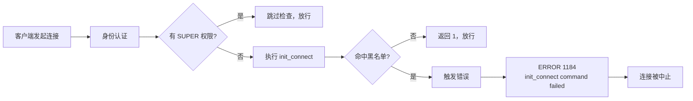

# MySQL 客户端软阻断

按 `user@ip` 粒度拒绝指定客户端连接，**不改密码、不重启、不影响同 IP 的其他账号**。

基于 `init_connect` 实现：连接认证通过后，服务端自动执行一段 SQL 做准入判断。命中黑名单就让这条 SQL 报错，连接被中止；未命中就放行。整个过程对业务透明，不需要改应用配置，也不需要中间件。

## 为什么不用 REVOKE

`REVOKE` 是收权限，不是关门，两个方向都不合适：

- **收得太宽**。MySQL 的账号是 `'User'@'Host'` 二元组，业务账号通常只有 `'app'@'%'` 一条记录，覆盖所有来源。REVOKE 一次，这条记录下的所有 IP 一起断——想封的那个还连着，不该封的先出事。
- **收不到已连会话**。权限在连接建立时已经加载进会话，REVOKE 管不到已经连着的线程，必须等它自己断开。

其他常见手段也都有短板：`iptables` / 安全组切的是 IP（同 IP 的其他实例一起误伤）；`ALTER USER ... ACCOUNT LOCK` 干净但要 5.7.6+；并发上限和 `KILL` 只管当下，客户端重连就回来。

## 阻断原理



命中黑名单时的报错方式，两个方案不同：

| 版本 | init_connect 内容 | 报错方式 | 客户端看到 | 服务端日志 |
|---|---|---|---|---|
| 5.5.5+ | `SELECT CASE WHEN EXISTS(...) THEN EXP(710) ELSE 1 END` | `EXP(710)` 溢出 | 1184 | 1690 |
| 5.0.3 ~ 5.1.x | `CALL security.check_blacklist_51();` | `INSERT` 主键冲突 | 1184 | 1062 |

`EXP(710)` 是因为 e^710 ≈ 2.2E308，刚好越过 DOUBLE 上限（≈1.8E308）。5.5.5 之前这个值只返回 `inf`，不报错，所以存在硬版本门槛。

## 两套方案怎么选

| 对比项 | 5.1 方案 | 5.5.5+ 方案 |
|---|---|---|
| 最低版本 | 5.0.3 | 5.5.5 |
| 触发方式 | `ERROR 1062` 主键冲突 | `ERROR 1690` DOUBLE 溢出 |
| 是否走 CALL 层 | 走 | 不走 |
| 额外表 | 需要 `block_trigger` | 不需要 |
| 业务用户需要的权限 | `EXECUTE ON PROCEDURE` | `SELECT ON security.client_blacklist` |
| 权限隔离 | 有（`SQL SECURITY DEFINER`） | 无（SQL 以业务用户身份执行） |
| 受 SQL mode 影响 | 不受 | 不受 |

> **边界是 5.5.5，不是 5.5。** 5.5.0 ~ 5.5.4 的 `EXP(710)` 不报错，脚本会提示降级到 5.1 方案。

## 目录结构

```
mysql_user_blocking/
├── mysql5.1block.sql      # 5.0.3 ~ 5.1.x 部署脚本（CALL + 主键冲突）
├── mysql5.5block.sql      # 5.5.5+ 部署脚本（inline EXP(710)）
└── sh/
    └── init_connect_set.sh # 一键部署 / 卸载脚本
```

三个文件里的 SQL 内容保持同步。`sh/` 目录下的脚本会自动判断版本并调用对应方案。

## 快速开始

### 方式一：一键脚本（推荐）

要求：本机有 `mysql` 客户端；管理员账号具备 **SUPER** 和 **GRANT OPTION** 权限（前者用于设置 `init_connect`，后者用于授权和回收）。

```bash
chmod +x sh/init_connect_set.sh

# 本地 socket 连接，交互输入密码
./sh/init_connect_set.sh -u root

# 远程连接
./sh/init_connect_set.sh -h 10.0.0.8 -P 3306 -u dba_root -p 'YourPass'

# 卸载
./sh/init_connect_set.sh -u root --uninstall
```

脚本会依次做八件事：

1. 连接测试 + SUPER / GRANT OPTION 权限确认
2. 检测版本，自动选择 5.1 或 5.5+ 方案（MariaDB 10.0+ 走 5.5+ 分支）
3. 环境检查：已有 `init_connect` 会提示覆盖确认；找不到任何 SUPER 账号直接中止
4. 建库、建表、建存储过程、建自动解封事件
5. **查询所有普通用户并逐个授权**（`GRANT`）
6. **最后才设置 `init_connect`**（总开关）
7. 询问是否写入 `my.cnf` 持久化（自动备份原文件，参数插入 `[mysqld]` 段内）
8. 逐项验证表、存储过程、事件、`init_connect`、授权并输出汇总

第 5 步在第 6 步之前，是刻意的顺序，见下方「部署铁律」。

### 方式二：手工执行 SQL

```bash
# 5.5.5 及以上
mysql -u root -p < mysql5.5block.sql

# 5.0.3 ~ 5.1.x
mysql -u root -p < mysql5.1block.sql
```

执行前记得把脚本「第四部分：权限配置」里的示例账号改成你自己的业务账号，并取消注释。手工执行时**授权必须放在设置 `init_connect` 之前**。

## 日常运维

部署完成后，所有操作都通过存储过程完成：

```sql
-- 封禁：写黑名单 + KILL 现有连接 + 写审计
CALL security.sp_block_client('app_user', '10.0.0.5', NULL, '非法 DROP TABLE', 'dba_zhang', NULL);
-- 参数：用户名, IP, 端口(可 NULL), 原因, 操作人, 过期小时数(NULL=永久)

-- 临时封 24 小时
CALL security.sp_block_client('app_user', '10.0.0.5', NULL, '异常批量删除', 'dba_zhang', 24);

-- 解封
CALL security.sp_unblock_client('app_user', '10.0.0.5', 'dba_zhang');

-- 查看活跃黑名单
CALL security.sp_show_blacklist();

-- 查看审计日志（默认 20 条）
CALL security.sp_show_audit_log(50);
```

到期解封由事件 `ev_auto_release_blacklist` 每小时跑一次：**先写 `auto_release` 审计，再把过期记录置为 `released`**。顺序反了会导致审计里漏掉这次释放。

审计表 `security.block_audit_log` 记录四类动作：`block`、`unblock`、`kill`、`auto_release`。

## 部署铁律

这三条踩过坑，都写在脚本里了，手工部署时同样适用：

**1. 先授权，后开门。** 业务用户没有 `SELECT ON security.client_blacklist`（5.5+）或 `EXECUTE ON PROCEDURE`（5.1）时，这条 SQL 跑不通，连接照样被拒。先设 `init_connect` 再授权，中间那段时间所有业务用户都会收到 1184。

**2. 至少保留一个 SUPER 账号。** 有 SUPER 权限的账号跳过 `init_connect`，这是整个方案唯一的保命通道——规则写错成什么样，DBA 都还能进去改回来。脚本在部署前会检查，一个都没有就直接中止。

**3. 先测，后上。** 在测试实例上完整走一遍「封禁 → 用该账号连 → 收到 1184 → 解封 → 恢复连接」，再上生产。

## 验证部署结果

```bash
./sh/init_connect_set.sh -u root
```

脚本末尾的验证环节会逐项检查表、存储过程、事件、`init_connect` 状态。手工验证可以直接查：

```sql
SELECT @@global.init_connect;                    -- 应返回阻断 SQL
SELECT @@global.event_scheduler;                 -- 应为 ON
SELECT TABLE_NAME FROM information_schema.TABLES WHERE TABLE_SCHEMA='security';
SELECT ROUTINE_NAME FROM information_schema.ROUTINES WHERE ROUTINE_SCHEMA='security';
```

端到端验证：

```sql
CALL security.sp_block_client('test_user', '10.0.0.9', NULL, '测试封禁', 'dba', 1);
```

然后用 `test_user@10.0.0.9` 发起连接，预期收到 `ERROR 1184 (08S01): ... (init_connect command failed)`。注意客户端可能拿到的是驱动包装过的 2013 或 2006，**判断是否生效要看服务端错误日志**。

验证完记得解封：

```sql
CALL security.sp_unblock_client('test_user', '10.0.0.9', 'dba');
```

## 卸载

```bash
./sh/init_connect_set.sh -u root --uninstall
```

卸载会清空 `init_connect`（关闭总开关）、回收所有 `EXECUTE` / `SELECT` 授权、删除事件和存储过程、删除 `security` 库。`my.cnf` 里的配置行不会自动删除，脚本会打印需要手工删掉的行和备份文件路径。

## 兼容性与验证状态

| 版本 | 支持 | 实测 |
|---|---|---|
| MySQL 5.0.3 ~ 5.1.x | ✅ 5.1 方案 | 5.1.73 已验证 |
| MySQL 5.5.0 ~ 5.5.4 | ⚠️ 降级到 5.1 方案 | — |
| MySQL 5.5.5+ / 5.6 / 5.7 | ✅ 5.5+ 方案 | 5.7 已验证 |
| MySQL 8.0 | ✅ 代码层面兼容 | **未实测** |
| MariaDB 10.0+ | ✅ 5.5+ 方案 | 未实测 |
| Percona 5.5+ | ✅ 5.5+ 方案 | 未实测 |

## 已知限制与待验证项

**方案本身的边界：**

- 业务经代理或中间件接入时，`USER()` 拿到的是代理身份，`user@ip` 粒度会失真
- 一台实例只有一个全局 `init_connect`，会覆盖已有的同名配置
- 黑名单只对新连接生效，所以封禁动作必须连带 `KILL`，否则已连着的会话不受影响
- 8.0 把 SUPER 拆成了 `CONNECTION_ADMIN`、`SYSTEM_VARIABLES_ADMIN` 等细粒度权限，「SUPER 账号跳过 `init_connect`」这条规则在 8.0 上是否仍成立，**需要实测确认**

**待验证：**

- `my.cnf` 持久化只验证到「写入」，尚未跑完「写入 → 重启 → 检查」完整链路。生产环境重启前请先手工确认配置生效
- 8.0 的 `caching_sha2_password` 成为默认认证插件后，对连接期执行 SQL 是否有影响
- 8.0 用 `CREATE ROLE` 收敛授权（脚本注释里有现成写法），比逐个账号 `GRANT` 更干净

**脚本注释中的四处笔误 / 过时描述**（不影响执行，阅读时注意）：

- `mysql5.1block.sql` 开头写的 `search.check_blacklist_51()` 应为 `security.check_blacklist_51()`，实际创建的是 `security` 库
- `sh/init_connect_set.sh` 用法示例里写成了 `init_connect_set.sh.sh`，实际文件名是 `init_connect_set.sh`
- 两个 SQL 脚本注释里提到的 `02-部署脚本-5.1版本.sql` / `03-部署脚本-5.5及以上版本.sql` 是历史命名，对应当前的 `mysql5.1block.sql` / `mysql5.5block.sql`
- `mysql5.1block.sql` 开头「5.1.62+ 打了补丁后 CALL 中的错误可能被吞噬，需改用 inline 方案」这句与实测结论不一致：5.1.73 上 `CALL + 主键冲突` 仍能正常阻断。该说法针对的是 SIGNAL 类软错误，主键冲突属于硬约束违反，不受影响

## 常见问题

**封禁后客户端报 2013 或 2006，不是 1184？**
在 5.1.62 之前的版本上，`init_connect` 里调用存储过程失败时，客户端拿到的是 2013 或 2006 而不是 1184——这正是 Bug #47032 报告的现象（连接被中止了，但客户端不知道原因）。5.1.62 / 5.5.21 / 5.6.5 之后修复，真实错误能在断开前报出来。判断是否真的阻断，去看服务端错误日志里的 `(init_connect command failed)`。

**5.1 上封禁没生效？**
检查三件事：`security.block_trigger` 表里是否有 `id=1` 这一行；存储过程里有没有声明 `HANDLER FOR 1062`（声明了错误会在过程内部被吃掉）；业务账号是否有 `EXECUTE ON PROCEDURE` 权限。

**改了 `init_connect` 但重启后失效？**
`SET GLOBAL` 是动态配置，重启即丢。必须写进 `my.cnf` 的 `[mysqld]` 段，并且注意转义规则：`my.cnf` 里用单引号包外层，内部单引号双写成 `''`。

**DBA 会不会把自己锁在外面？**
只要保留至少一个 SUPER 账号就不会。`init_connect` 对 SUPER 账号不生效。
